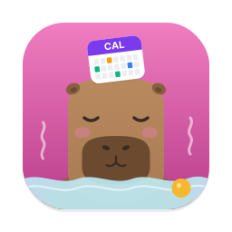

<p align="center"></p>

# Capycal

[](https://github.com/twiebe/capycal/actions/workflows/ci.yml)
[](https://github.com/twiebe/capycal/releases)
[](https://capycal.app/docs/)
[](LICENSE)
[](https://github.com/sponsors/twiebe)

Capycal is calendar sync for the Mac, Linux and servers. It copies events from one calendar to another and removes everything you don't want the other side to see. It works with any CalDAV server and, on macOS, with every calendar in Calendar.app via EventKit.

A meeting called "Board Review: Q3 Financials" in your work calendar becomes "Busy (work)" in your personal calendar. The slot is blocked, the content stays private.

## Why

Work and personal calendars usually live with different providers (Google Workspace, Exchange, iCloud, Nextcloud, self-hosted). Colleagues need to see when you're busy privately, and your family needs to see when you're in meetings, without either side seeing the details.

Capycal syncs events one way, from source to target, and copies only the iCal properties you opt into. Transforms rewrite or drop the rest.

On macOS, Capycal can read from Calendar.app directly. Calendar.app already aggregates Google, Exchange, iCloud and local calendars, so you get all of them without dealing with OAuth or Exchange authentication.

## Features

- **Opt-in content**: times, recurrence, status and free/busy are always copied, cancelled events are skipped. Content such as `SUMMARY`, `LOCATION` or `VALARM` is copied only when you list it in `fields`
- **Transforms**: set, replace (text or regex) or remove fields, add buffers before/after events, add alarms, skip events. Each can have conditions (weekday and time, all-day, a text or regex in any property), such as travel time only for events with a location. Placeholders like `{{source_name}}`
- **Any combination of backends**: CalDAV to CalDAV, Calendar.app to CalDAV, CalDAV to Calendar.app, Calendar.app to Calendar.app, plus read-only iCal feeds as a source (Google's secret address, Outlook.com, any `.ics` URL)
- **Bidirectional setups**: markers on synced events prevent sync loops
- **Efficient**: RFC 6578 sync-tokens with ctag/etag fallback, per-calendar request limits, exponential backoff on 429/5xx with `Retry-After`
- **Discovery**: `--discover` finds calendars on a CalDAV server (RFC 6764), `--discover-eventkit` lists Calendar.app calendars, both print ready-to-paste config
- **Operations**: daemon or one-shot (`--once`), config reload on `SIGHUP` or automatically when the file changes, `--full-sync` to compare source and target and repair the difference, `--purge` to remove everything Capycal created, `--status` to see each sync's state
- **Safe state**: crash-safe JSON state files (write, then rename) that are only a cache: lost or corrupt state is rebuilt from the markers in the target, and periodic full syncs clean up duplicates and events that filters now drop
- **Linux service**: `.deb`, `.rpm` and AUR packages with man page, shell completions and systemd units; `--install-service` sets up the user service, passwords can come from a password manager or keyring command
- **Desktop app (macOS)**: `Capycal.app` lives in the menu bar, runs your syncs in the background and shows their status, a live log and Start at Login. It writes a commented starter config on the first start, lists your Calendar.app calendars for the config and removes a sync's events on request
- **Desktop app (Linux)**: `capycal-app` does the same from a tray icon with GTK 4 / libadwaita windows, and discovers the calendars of a CalDAV account for the config

## Install

| Platform | Download from the [releases page](https://github.com/twiebe/capycal/releases) |
|---|---|
| macOS desktop app (Apple silicon, macOS 14+) | `capycal-v<version>-macos.dmg`, includes the CLI |
| macOS CLI (Apple silicon) | `capycal-v<version>-aarch64-apple-darwin.tar.gz` |
| Linux x86_64 / arm64 (static) | `.deb`, `.rpm`, or `capycal-v<version>-{x86_64,aarch64}-unknown-linux-musl.tar.gz` |
| Arch Linux | AUR packages `capycal-bin` (CLI) and `capycal-app-bin` (desktop app) |
| Homebrew (macOS, Linux) | `brew install twiebe/capycal/capycal`, app: `brew install --cask twiebe/capycal/capycal-app` |
| Linux desktop app (GTK 4.14+) | `capycal-app` `.deb` / `.rpm` |

The macOS app and binary are not notarized: right-click the app and choose Open, or run `xattr -dr com.apple.quarantine /Applications/Capycal.app`.

From source: `cargo install --git https://github.com/twiebe/capycal`. A `Dockerfile` and `docker-compose.yml` are included.

Details, including the static Linux binaries and Docker: [Installation](https://capycal.app/docs/installation.html).

## Quick start

```bash
capycal --generate-config                        # starter config at the default path
capycal --discover https://caldav.example.com    # find calendars, prints config snippets
capycal --discover-eventkit                      # the same for Calendar.app (macOS)
capycal --validate                               # check the config
capycal --once -v                                # run all syncs once with debug output
capycal                                          # run as a daemon
```

A minimal config that copies work meetings as "Busy" blockers into another calendar:

```toml
[daemon]
log_level = "info"

[accounts.work]
url = "https://caldav.example.com/"
username = "alice"
password = { env = "CAPYCAL_WORK_PASSWORD" }

[accounts.nextcloud]
url = "https://cloud.example.org/remote.php/dav/"
username = "alice"
password = { env = "CAPYCAL_HOME_PASSWORD" }

[calendars.work]
account = "work"
url = "https://caldav.example.com/calendars/alice/work/"

[calendars.blockers]
account = "nextcloud"
url = "https://cloud.example.org/remote.php/dav/calendars/alice/work-blockers/"

[syncs.work-to-blockers]
source = "work"
target = "blockers"
interval = "5m"

transforms = [
  { field = "SUMMARY", action = "set_field", value = "Busy ({{source_name}})" },
]
```

On a Mac or a Linux desktop, the desktop app does the same without a terminal: start it and add a sync in Settings. See the [desktop app quick start](https://capycal.app/docs/app/quick-start.html).

## Documentation

The full documentation is at **[capycal.app/docs](https://capycal.app/docs/)**:

- [Desktop app](https://capycal.app/docs/app/quick-start.html), [config file](https://capycal.app/docs/cli/config-file.html) and the [option reference](https://capycal.app/docs/reference/options.html)
- [How syncing works](https://capycal.app/docs/concepts/syncs.html), [transforms](https://capycal.app/docs/concepts/transforms.html) and the [Cookbook](https://capycal.app/docs/cookbook/index.html)
- [Running on a server](https://capycal.app/docs/cli/server.html), [macOS and Calendar.app](https://capycal.app/docs/concepts/calendar-app.html)
- [CLI reference](https://capycal.app/docs/cli/reference.html) and [troubleshooting](https://capycal.app/docs/troubleshooting.html)

The sources are in [`docs/src`](docs/src). For development, see [Building and testing](https://capycal.app/docs/development/building.html), the [architecture](docs/src/development/architecture.md) and [`CLAUDE.md`](CLAUDE.md).

## Support

Capycal is made by Thomas Wiebe ([heimblick.net](https://heimblick.net)), free and developed in my spare time. If it saves you time, consider [sponsoring it on GitHub](https://github.com/sponsors/twiebe) or [supporting it on Ko-fi](https://ko-fi.com/thomaswiebe).

## License

Copyright (C) 2026 Thomas Wiebe. Capycal is free software: you can redistribute it and/or modify it under the terms of the GNU General Public License version 3 as published by the Free Software Foundation. It is distributed without any warranty; see [LICENSE](LICENSE).

Contributions are accepted under the MIT License, see [CONTRIBUTING.md](CONTRIBUTING.md).
