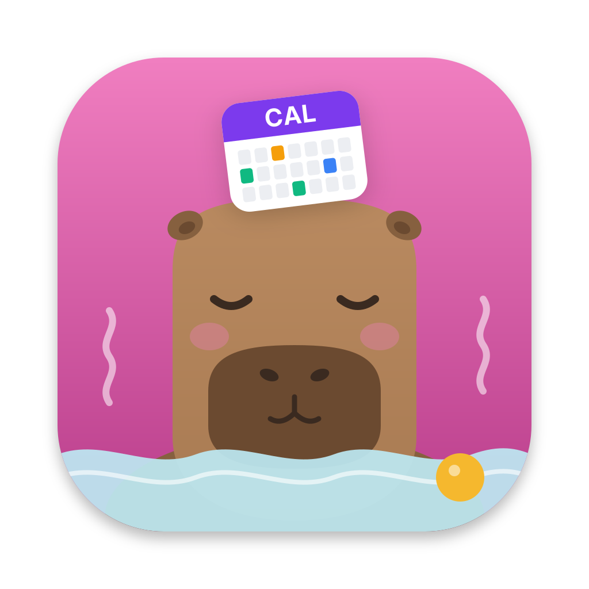

# Capycal

Capycal is calendar sync for the Mac, Linux and servers. It copies events from one calendar to another and removes everything you don't want the other side to see. It works with any CalDAV server and, on macOS, with every calendar in Calendar.app through EventKit.

A meeting called "Board Review: Q3 Financials" in your work calendar becomes "Busy (work)" in your personal calendar. The slot is blocked, the content stays private.

## Why

Work and personal calendars usually live with different providers: Google Workspace, Exchange, iCloud, Nextcloud or a self-hosted server. Colleagues need to see when you are busy privately, and your family needs to see when you are in meetings, without either side seeing the details. Most providers can't share free/busy information with each other, so the usual workaround is copying events by hand.

Capycal does this copying for you:

- It syncs one way, from a **source** calendar to a **target** calendar. Two syncs in opposite directions give you a two-way setup.
- It copies when an event takes place and whether it blocks time. Titles, descriptions, attendees and locations stay behind unless you list them in `fields`.
- **Transforms** rewrite what is left: set the title to "Busy", add travel buffers or reminders, drop weekend or all-day events.
- Created events carry a marker, so Capycal never copies its own blockers back and can remove them again.

On macOS, Capycal can read from and write to Calendar.app directly. Calendar.app already aggregates Google, Exchange, iCloud and local calendars, so you get all of them without dealing with OAuth or Exchange authentication. On any platform, Capycal can also read a calendar from its private iCal address, such as Google's secret address, as a read-only source.

## Two ways to run it

| | Desktop app | `capycal` CLI |
|---|---|---|
| Platforms | macOS 14 or later, Linux (GTK) | Linux, macOS |
| Runs as | menu bar or tray app, optional Start at Login | daemon, one-shot (`--once`), systemd / launchd / Docker service |
| Setup | Settings window with an assistant | TOML file |
| Status | status per sync in the menu and in Settings, live log window | logs (pretty or JSON), `--status` |

Both use the same sync engine and the same config file: the app writes the TOML for you, and you can edit it by hand next to it. Use the app on a computer you are logged in to, and the CLI on a server or for scripting.

This book follows that split. After [Installation](installation.md), **Desktop app** and **CLI and server** each start with a quick start. **How syncing works** explains calendars, syncs, transforms and full syncs for both: every option names its place in Settings and its key in the config. The **Cookbook** shows common setups both ways, the **Reference** lists every config option.

## Terms used in this book

- **Calendar**: a named entry under `[calendars.<name>]`: a CalDAV collection, a Calendar.app calendar or a read-only feed (an iCal address). A calendar can be the source of one sync and the target of another.
- **Sync**: one `[syncs.<name>]` table that copies events from a source to a target every `interval`.
- **Blocker**: a stripped-down copy of an event that only blocks the time slot.
- **Marker**: the `X-CAPYCAL-SOURCE` / `X-CAPYCAL-SYNC` properties (or a `[capycal:...]` line in the notes for Calendar.app) on every event Capycal creates. It names the sync and the source event, so Capycal can find its events again without its state files.

## Support

Capycal is free and open source. If it is useful to you, you can support its development through [GitHub Sponsors](https://github.com/sponsors/twiebe) or [Ko-fi](https://ko-fi.com/thomaswiebe).
